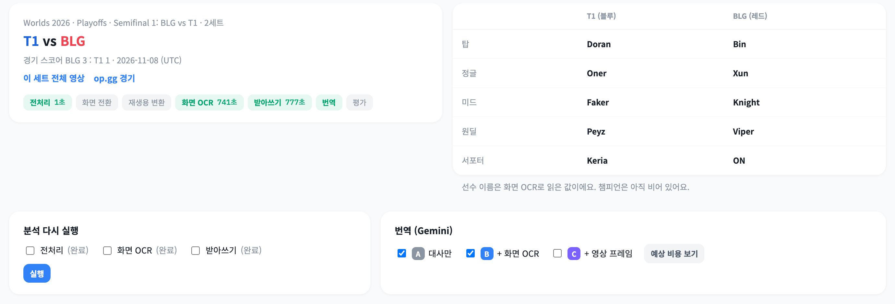
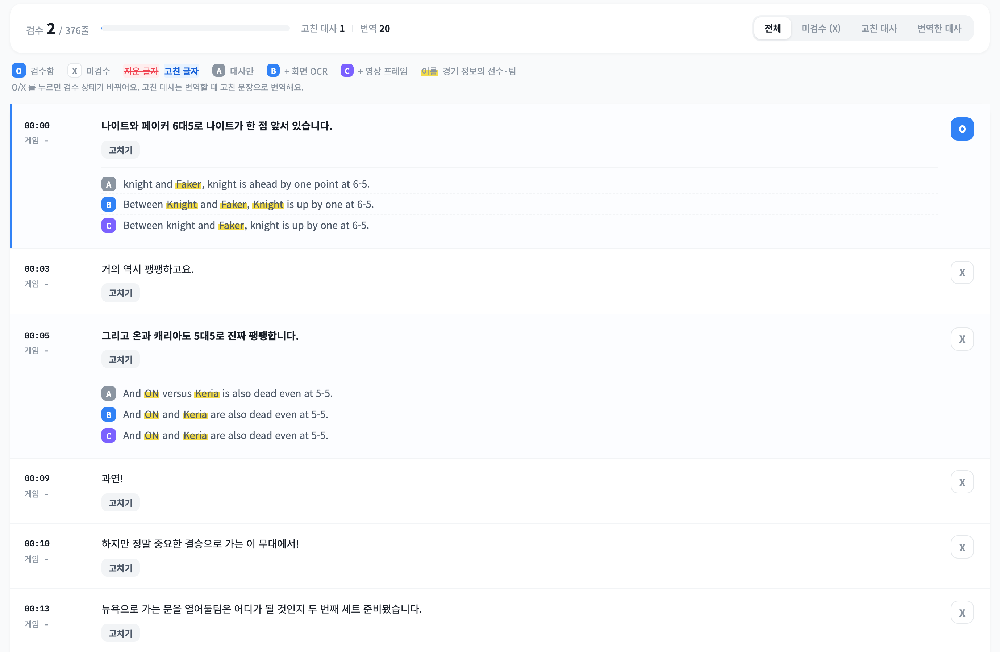
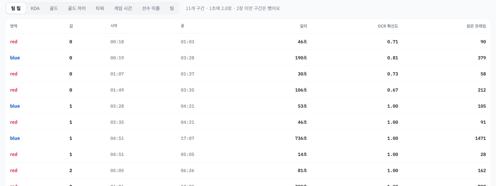

# esports-ui

LoL 중계 번역 실험의 화면 (Django 템플릿). [esports-api](https://github.com/Esports-local/esports-api)를 호출해서 보여 준다.

- 계획·실험 조건: [esports-analyzer/docs/PLAN.md](https://github.com/Esports-local/esports-analyzer/blob/main/docs/PLAN.md)
- 함께 쓰는 레포: [esports-api](https://github.com/Esports-local/esports-api) (데이터) · [esports-analyzer](https://github.com/Esports-local/esports-analyzer) (분석)

## 화면

**세트 화면**: 경기 정보, 분석 단계 상태, 화면 OCR로 읽은 포지션별 선수, 분석 다시 실행과 번역 조건 선택



**대사·번역 + 검수** (`?tab=lines`): 받아쓴 해설(ASR 한국어) 아래에 조건별 영어 번역을 쌓아 비교한다. 경기 정보의 선수·팀 이름은 형광펜으로 표시하고, O/X 로 검수하거나 "고치기"로 문장을 바로잡으면 고친 문장으로 다시 번역한다



**화면 OCR 구간** (`?tab=screen`): 영역별(팀 킬, KDA, 골드, 타워, 게임 시간, 선수 이름 등)로 같은 값이 이어진 구간. OCR 확신도는 OCR 모델이 그 값을 읽으며 낸 확신 점수의 평균(0~1), 읽은 프레임은 그 구간에서 같은 값을 읽은 프레임 수(1초에 2장씩 봄)



| 주소 | 내용 |
|---|---|
| `/` | 세트 영상 목록 (해설 언어, 블루 vs 레드, 길이, 분석 상태) |
| `/games/new/` | 영상 추가: vod 폴더에서 1920x1080 영상을 골라 경기·세트·언어를 지정하고 분석 시작 |
| `/games/<id>/` | 세트 화면: 경기 정보, 단계 상태(분석 중이면 10초마다 새로고침·중지), 분석 다시 실행, 번역 조건 선택 → 예상 비용 → 번역 시작 |
| `/games/<id>/?tab=lines` | 대사·번역 (A 대사만 / B + 화면 OCR / C + 영상 프레임), 그 시점 게임 시간·킬. 대사 검수(O/X, 고치기·되돌리기, ASR 원문과 글자 단위 비교), 검수 진행률, 필터 `only=unreviewed\|edited\|translated` |
| `/games/<id>/?tab=screen&tag=` | 화면 OCR 구간 |
| `/games/<id>/?tab=json&stage=` | 분석 단계 결과 원본 |

다음에 할 것: 케이스셋 검수 화면(`/cases`), 영상 재생(HLS)

## 실행
esports-api 의 compose 에 `ui` 서비스로 들어 있어서 api·analyzer 와 같이 뜬다:
```
cd ../esports-api && docker compose up --build
```
브라우저에서 **http://localhost:8000** (api 는 :8002, analyzer 는 :8001).

ui 만 따로 띄우려면 (api compose 가 떠 있어야 함):
```
docker build -t esports-ui .
docker run --rm --network esports_default -p 8080:8080 -v "$PWD":/app esports-ui   # → http://localhost:8080
```
api 주소는 `API_URL` 환경변수 (기본 `http://api:8000`, compose 네트워크 안의 주소).
